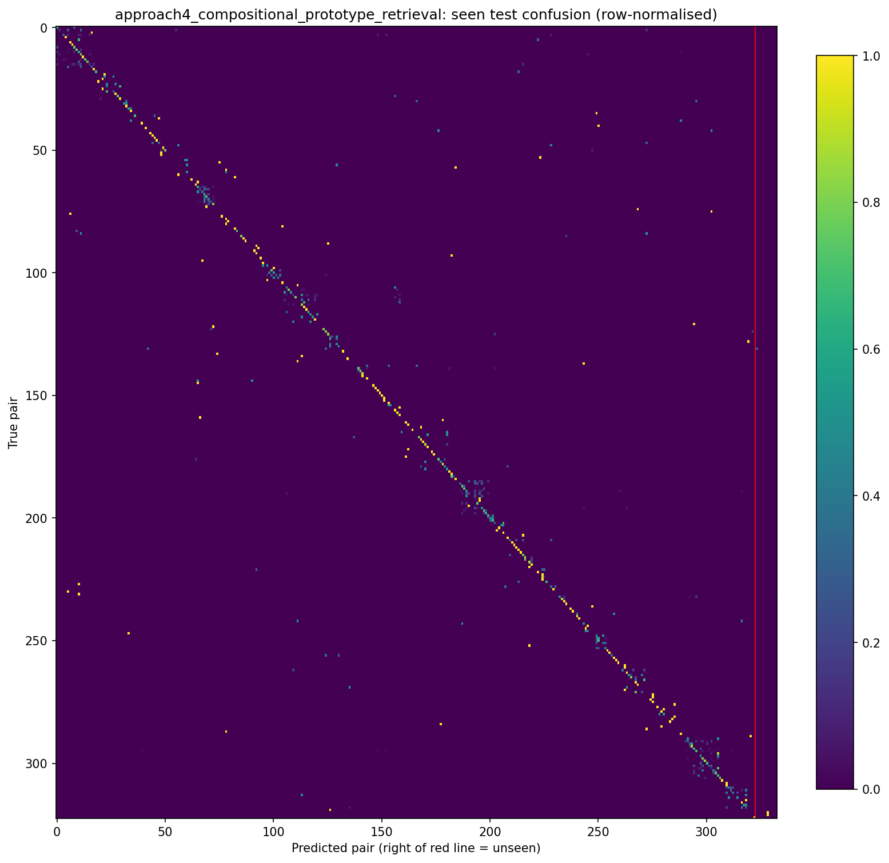

# Compositional prototype retrieval: completed experiment

Date: 27 October 2026, Malaysia time. Branch:
`approach4-compositional-prototype-retrieval`.
[Draft PR #1](https://github.com/COS30082-ML-Project-2026/COS30082-Plant-Disease-OOD/pull/1).

## What was built

A fourth approach using frozen **DINOv2 ViT-B/14** features and two learned
256-dimensional crop/disease projections. Training-only visual prototypes are
balanced across observed partner concepts, then combined to score all 333 pairs,
including the 10 unseen compositions. Auxiliary concept classification and
prototype cross-entropy train the projection heads; the DINOv2 backbone is not
fine-tuned. Retrieval returns separate crop/disease exemplars and joint visual
neighbors, with their actual labels.

[Scope, method diagram and task distribution](approach4_scope.md) and
[Colab instructions](../colab/README.md) describe the implementation in detail.

## Action summary

| Action | Completed outcome |
| --- | --- |
| Read the two supplied PDFs and inspect the repository | Used the scope/task/notebook format as reference; embedded assistant instructions in the PDFs were not treated as user commands |
| Create an isolated branch | Added approach 4; retained existing approaches, baselines, shared source and app selection |
| Implement the model | Frozen DINOv2, learned concept projections, partner-balanced prototypes and 333-pair scoring |
| Implement training | Frozen feature caches, AdamW, 30 head epochs, validation-based epoch selection, fixed zero seen bias |
| Implement retrieval and loading | Training-only exemplar memory and checkpoint restoration without a pretrained download |
| Download the dataset | Downloaded the 3,399,045,528-byte SharePoint archive locally; used the user's Drive copy in Colab |
| Extract and validate data | Verified 8,000 / 2,000 / 1,448 images, expected pairs and concept coverage, safe paths and filename-disjoint splits |
| Verify shared data loading | Confirmed 7,223 / 777 / 2,000 / 1,448 loader sizes, 333-pair table and finite 224x224 image tensors |
| Run local checks | Seven unit/integration checks passed, including optimization and support split isolation |
| Run Colab | Completed DEBUG and full experiments on Tesla T4; kept DEBUG artifacts separate |
| Evaluate | Saved full Top-1/5, harmonic mean, seen confusion matrix and shared corruption results |
| Verify saved weights | Reloaded checkpoint, checked finite [2,333] scores, exact pair order, 7,223 memory entries and zero validation overlap |
| Preserve evidence | Saved weights, logs, environment, archive SHA-256, history, metrics and retrieval example locally and to Drive |
| Deliver source | Opened the checkout in VS Code, pushed the branch and created a draft PR; no merge performed |

## Full results

| Metric | Result |
| --- | ---: |
| Seen Top-1 | 61.00% |
| Seen Top-5 | 86.90% |
| Unseen Top-1 | 5.59% |
| Unseen Top-5 | 33.84% |
| Harmonic mean of seen/unseen Top-1 | 10.24% |
| Crop accuracy from the top predicted pair, seen images | 93.90% |
| Disease accuracy from the top predicted pair, seen images | 62.25% |

Best validation epoch: **26 of 30**, validation Top-1 **76.45%** over all 333
candidates. Evaluation used that checkpoint. The validation set contains only
seen training compositions. No test image was used for prototype fitting, model
selection or hyperparameter tuning. No calibration sweep on unseen test images
was performed.

| Shared seen-image robustness test | Top-1 | Drop from clean |
| --- | ---: | ---: |
| Reduced brightness | 60.95% | 0.05 percentage points |
| Blur | 58.50% | 2.50 percentage points |
| Noise | 51.30% | 9.70 percentage points |

The confusion CSV was independently checked to contain 323 rows, 333 columns and
2,000 observations; its diagonal reproduces 61.00% seen accuracy. Local and Colab
archive hashes match:
`9f70f7385b86a865c82a6db4f10756ca90defd54bb3954b73f7eee52b5cea948`.

## Interpretation and limits

This is a working, reproducible first experiment, but unseen Top-1 is low and the
harmonic mean is correspondingly weak. Disease recognition is the larger observed
bottleneck than crop recognition. These results do not establish that the approach
beats either baseline: baseline result files were not available in the repository.
Noise causes the largest measured corruption drop. Shared synthetic corruption
tests do not substitute for evaluation on an independent field-image dataset.

Only one augmented view per training image was cached, rather than refreshing
augmentation each epoch. The visual-prototype formulation requires each unseen
pair's component crop and disease to have training support; it cannot identify
entirely new concepts without extra semantic information. Equal partner weighting
does not guarantee disentangled features. Potential DINOv2 pretraining overlap
with this dataset is unknown. Future improvements should be designed and selected
using training/validation data, ideally with held-out pseudo-unseen compositions;
the reported test set must not be used to tune them.

## Runtime and artifacts

Colab used Python **3.13.16**, torch **2.11.0+cu130**, torchvision **0.26.0+cu130**,
timm **1.0.30**, CUDA **13.0**, Tesla T4, numpy **2.1.3**, pandas **2.2.3**,
py7zr **1.1.4**, gdown **5.2.2**. This differs from the team's pinned Python 3.11 /
torch 2.9.1 environment: Colab's working GPU packages were preserved. Exact
cross-model reproducibility should use a common runtime. The shared data split,
transforms, evaluation implementation, seed and candidate ordering were retained.

Training source commit: `dd3a82cd39dc7b4bb8697dd3fd4954e0257a89ac`; model/training
source hashes are recorded in the runtime JSON. Later commits add tests,
documentation and outputs without changing the trained model implementation.

- [Colab experiment notebook](https://colab.research.google.com/drive/1HPJNy3r6GP5LSzG_IjtrDGDSp46qAP-r)
- [Drive experiment artifacts](https://drive.google.com/drive/folders/1QsCUcS4BaDy98sMnumM88KuyVtnU2ZZo)
- [Full metric JSON](../results/approach4_compositional_prototype_retrieval.json)
- [Training history](../results/approach4_compositional_prototype_retrieval_training.json)
- [Runtime and source hashes](../results/approach4_compositional_prototype_retrieval_runtime.json)
- [Saved-model verification](../results/approach4_compositional_prototype_retrieval_checks.json)

Weights are in Drive and the ignored local `checkpoints/` folder. DEBUG logs and
weights are also retained in the ignored `outputs/colab_run/` bundle. Data and
weights were excluded from Git. The dataset itself remains in the user's supplied
Drive file, rather than being uploaded again.

## Issues resolved during execution

Normal writes to the initial Documents workspace failed, so development used the
other authorized workspace and that checkout was opened in VS Code. Direct
SharePoint access returned HTTP 403, but its browser download completed. A slow
local Python extraction was replaced with Windows tar; the partial extraction was
removed after complete validation. The GitHub connector could not create a PR,
so the browser was used. Colab initially failed to display the Drive mount output;
the public Drive link allowed training to proceed. After the user completed Drive
authorization, artifacts were copied directly from Colab. The Drive connector's
512 MiB upload limit prevented uploading the combined 624 MiB ZIP through that
connector; direct Drive copying preserved the individual files instead.
